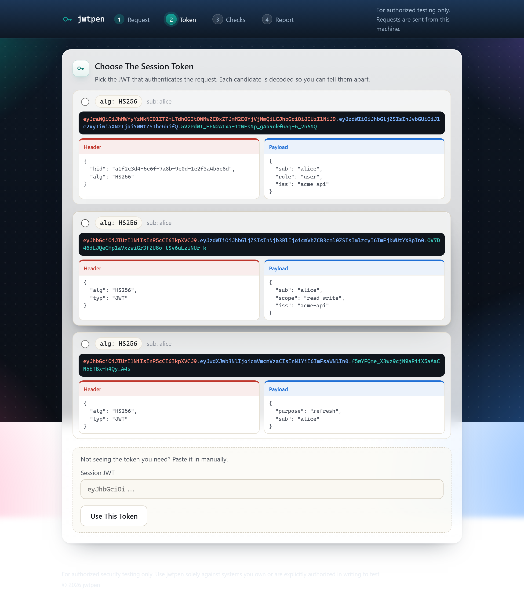
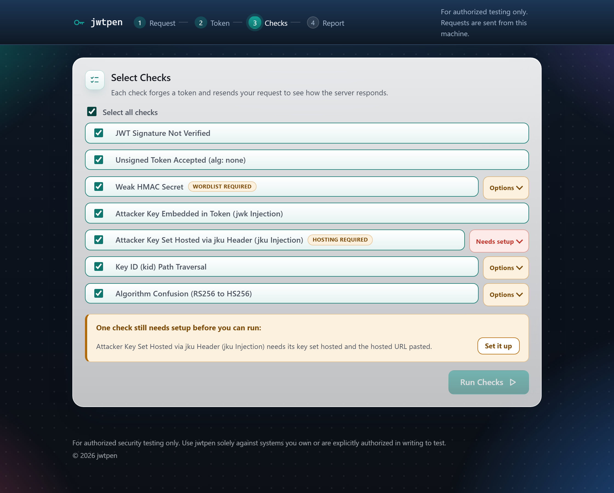
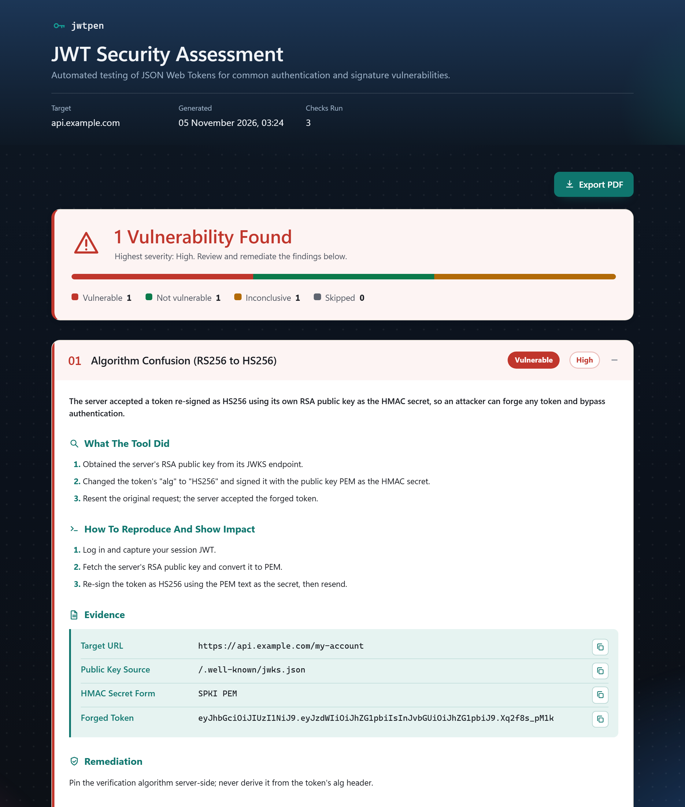

# jwtpen

A local web app that tests JSON Web Tokens for seven common vulnerability classes, forges the proof-of-concept tokens, and generates a reproducible HTML/PDF report.


Paste a raw HTTP request from Burp, confirm the session JWT, and select the checks to run. jwtpen rebuilds that exact request with each forged token swapped in and sends it from the backend, so there are no CORS or cookie limits.

## Contents

- [Authorized use only](#authorized-use-only)
- [Checks](#checks)
- [How it works](#how-it-works)
- [Setup](#setup)
- [Usage](#usage)
- [Tests](#tests)
- [Screenshots](#screenshots)
- [License](#license)

## Authorized use only

This is a penetration-testing tool. Use it only against systems you own or are explicitly authorized in writing to test. Unauthorized testing is illegal, and you are responsible for how you use it.

Reports contain live credentials: the captured session token, any cracked secret, and generated private keys. Treat them as engagement evidence. See [SECURITY.md](SECURITY.md).

## Checks

| Check | What it detects |
| :--- | :--- |
| Unverified signature | Server accepts a token after its signature is tampered with |
| `alg: none` | Server accepts an unsigned token; all 16 case variants are tried |
| Weak HMAC secret | Guessable signing secret cracked from a wordlist, then reused to re-sign |
| JWK injection | Attacker key embedded in the token's `jwk` header is trusted |
| JKU injection | Token's `jku` points at an attacker-hosted key set |
| KID path traversal | `kid` abused as a file path |
| Algorithm confusion | RSA public key used as an HMAC secret (RS256 to HS256) |

Each finding records methodology, evidence, manual reproduction steps, remediation and references, and exports to PDF.

## How it works

**Detection.** Paste a raw request and jwtpen finds the JWT candidates, validating that each is really a token rather than dotted text, and decodes them so you can confirm which one authenticates the request. A manual paste fallback is always available.

**Baselines, learned automatically.** Your valid token shows what "accepted" looks like and a deliberately broken one shows "rejected", so every forged token is judged against both. When the two baselines are indistinguishable, the result is reported as inconclusive rather than guessed.

**Byte-identical resends.** Only the token is swapped. Every other cookie, header and body byte stays exactly as captured.

Checks that need input ask for it when selected: weak secret takes a wordlist, built-in or your own; JKU injection hands you a key set to host and takes its URL back; KID traversal takes an optional file path; and algorithm confusion auto-discovers the public key or takes a PEM or JWKS URL.

## Setup

Requires Python 3.11 or newer.

```bash
python -m venv .venv
.venv\Scripts\Activate.ps1      # Windows PowerShell
# source .venv/bin/activate     # macOS / Linux
pip install -r requirements.txt
playwright install chromium     # one-time, for PDF export
```

<details>
<summary><strong>Reproducible install (recommended for engagement work)</strong></summary>

`requirements.txt` states the minimum versions jwtpen needs and lets pip pick the newest that fit, so two people installing a week apart can end up with different builds. `requirements.lock.txt` pins every package to an exact version with a SHA-256 hash:

```bash
pip install --require-hashes -r requirements.lock.txt
```

`--require-hashes` makes pip refuse any package whose contents do not match the recorded hash, so a tampered or substituted release fails to install instead of running.

The lock file is generated on Python 3.14. On older supported versions install from `requirements.txt` instead. Regenerate it after changing a dependency:

```bash
pip-compile --generate-hashes --output-file=requirements.lock.txt requirements.txt
```

</details>

## Usage

```bash
python -m uvicorn jwtpen.webapp.server:app
```

Open http://127.0.0.1:8000, which listens on loopback only. Then paste the request, confirm the token, pick the checks, and run.

## Tests

```bash
pytest                  # all 173 tests
pytest -m "not slow"    # skip the PDF render
```

The suite never touches the network and never binds a port. A guard fails any test that attempts a real request, so running it cannot reach a live host by accident. See [tests/TEST-PLAN.md](tests/TEST-PLAN.md).

## Screenshots

<p align="center">
  <br>
  <em>Auto-detected JWT candidates, decoded for confirmation.</em>
</p>

<p align="center">
  <br>
  <em>Check selection, each showing the setup it needs.</em>
</p>

<p align="center">
  <br>
  <em>The report: methodology, evidence, reproduction and remediation.</em>
</p>

## License

Released under the [MIT License](LICENSE).
